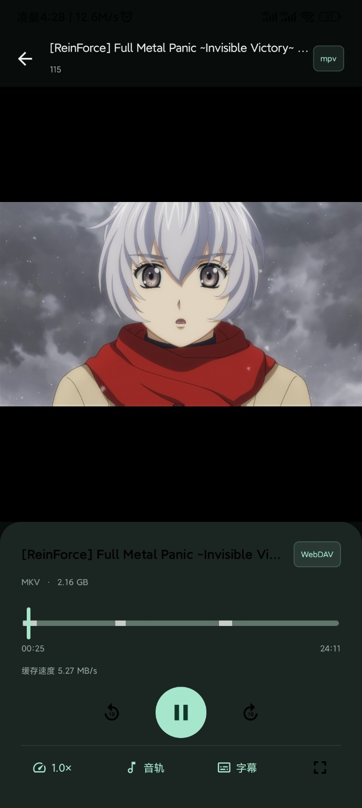
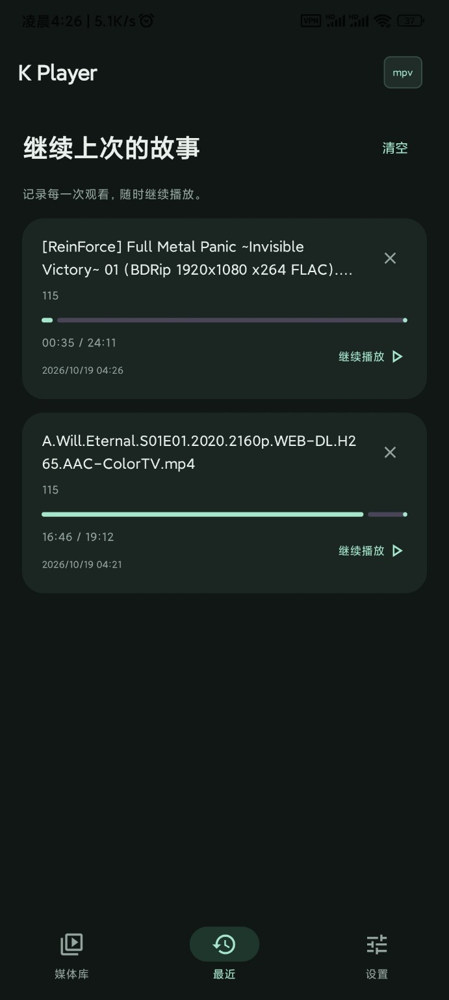
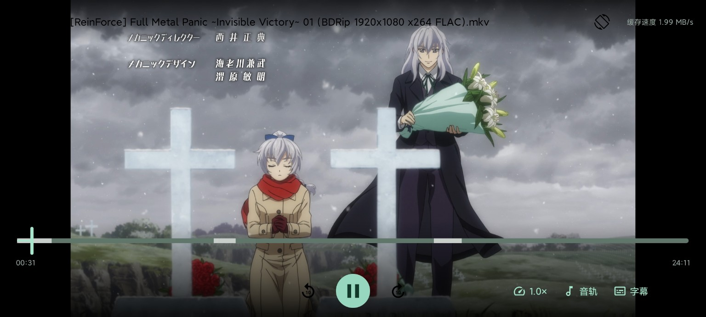

# K Player

安卓 WebDAV 视频播放器，中文深色界面，使用 libmpv 播放内核。最低 Android 8.0，发布 APK 支持 **arm64-v8a**。

[下载 Android APK](https://github.com/fastchenn/KPlayer/releases/download/v0.3.2/k-player-0.3.2-arm64.apk) · [查看发布说明](https://github.com/fastchenn/KPlayer/releases/tag/v0.3.2)

## 界面预览

实际 Android 界面截图，点击图片可查看原图。

<p align="center">
  <a href="docs/screenshots/player-portrait.jpg"></a>
  <a href="docs/screenshots/history.jpg"></a>
</p>
<p align="center"><sub>竖屏播放 · 观看记录</sub></p>

<p align="center">
  <a href="docs/screenshots/player-landscape.jpg"></a>
</p>
<p align="center"><sub>横屏播放：进度条显示多个不连续的缓存区间</sub></p>

## 下载

从 [0.3.2 Release](https://github.com/fastchenn/KPlayer/releases/tag/v0.3.2) 下载 `k-player-0.3.2-arm64.apk`。同页提供原生组件对应源码、APK 签名信息和 `SHA256SUMS.txt`。

0.3.2 为关闭调试的正式 Release APK，沿用 0.3.1 的固定 K Player Release 专用证书，可覆盖升级 0.3.1 并保留应用数据。后续发布已配置为通过 GitHub Actions 加密 Secret 使用同一密钥签名，维护者保留独立备份。0.2.5 的旧签名私钥目前未找到，0.3.0 使用另一把 CI 临时密钥，因此本版不能直接覆盖这些旧签名版本。若提示签名冲突，请保留原应用和数据；卸载会清除配置、观看记录及缓存。本版没有自动迁移，后续正式版将沿用 0.3.1 的固定密钥。

## 功能

- WebDAV 连接管理、目录浏览、当前目录搜索与筛选；支持匿名与 Basic 认证、中文及特殊字符路径。
- 真实视频和音频播放，暂停、前后十秒、拖动、倍速、内嵌音轨和字幕选择。
- 自动发现同目录 SRT / ASS / SSA / VTT 外挂字幕，支持同名、语言后缀和保留视频扩展名的命名，例如 `电影.sc.ass`、`电影.zh-CN.srt`、`电影.mkv.ass`；匹配的多条字幕可切换或关闭。
- 全屏播放，90° 横竖屏切换，底部居中的播放按钮，顶部文件名栏显示下载速度；轻触切换控制栏，播放时 4 秒无操作自动隐藏，长按画面临时 2 倍速。
- 本机观看历史、断点续播、从历史定位视频所在文件夹、删除或清空记录，以及媒体库标题和说明文字编辑。
- 视频与外挂字幕持久缓存，设置中可查看大小、开关缓存、选择容量及确认清除；默认开启，上限 5 GB，可选 2 / 5 / 10 / 20 / 50 GB。
- 自定义启动图标，设置页直接显示设置选项；“关于”显示版本并可直接打开 GitHub 仓库。

示例媒体库标注为“示例”，仅供离线界面预览，不请求服务器，也没有可播放视频。切后台暂停，前台播放保持亮屏。

## 缓存行为

已读取的视频和字幕保存在应用私有持久目录 `noBackupFilesDir/playback`，退出、结束进程后保留。数据边读边落盘，未完成的块也可在下次继续；已缓存区域的播放和拖动直接读取本机。

缓存按账号、连接、文件路径及 WebDAV 文件大小和修改时间识别，不依赖 OpenList 临时签名、CDN ETag 或回环端口。历史记录命中本地索引时直接恢复视频和字幕，不等待 PROPFIND、HEAD 或新直链。支持 chunked、限制 Range 长度及忽略 Range 的响应；本机保存不因源站 `Cache-Control: no-store` 而关闭。写入或协议异常会在设置页显示原因。

进度条白色区段表示已确认落盘的可拖动时间段，可显示多个不连续区段，并在再次打开后恢复。时间段取自 mpv 的实际可拖动范围，并关联当时已读取的文件字节；完整文件缓存可覆盖整个已知时长。白条不会按文件大小和时长的比例猜测。记录在后台约每秒更新，缓存清理、关闭或相关数据被淘汰后同步撤下。旧版缓存仍可使用；升级后播放一次可建立时间段记录。

时间段关联采取保守策略，会包含容器头、索引及此前读取的数据。部分依赖被淘汰后，可能同时隐藏一段实际仍能本地播放的区域；白条也不承诺硬件解码和精确定位零耗时。时间段索引不保存服务器地址、账号或认证信息。

容量为所有文件共享的上限，达到上限会淘汰最久未使用的数据。关闭缓存会保留文件；主动清除、缩小容量、清除应用数据或卸载会删除相应数据。**未下载的区域仍需联网**；忽略 Range 的源站首次跳到未缓存位置时，仍需读取前面的字节。源文件被替换后，从媒体库重新打开以获取最新版本。尚无独立离线媒体库页面。

0.3.2 在观看历史新增“定位文件夹”，直接浏览视频所在的 WebDAV 目录；点击卡片仍继续播放。定位目录需要联网，原连接失效时按钮禁用。本次未修改播放和缓存逻辑，也未运行真机或模拟器设备测试。[发布说明](docs/releases/v0.3.2.md)和[验证记录](docs/verification/v0.3.2.md)列出检查结果与范围，旧版验证记录保留。

## 构建与测试

日常更新可以完全通过 GitHub 完成，无需维护本地源码。**Actions → Signed release** 支持构建固定证书签名的正式 APK，也可选择发布新版本；操作步骤见[通过 GitHub 更新和发布](docs/GITHUB_RELEASE.md)。本机只需妥善保留签名密钥备份。

[云端签名构建已验证通过](https://github.com/fastchenn/KPlayer/actions/runs/39194464509)：133 项应用和播放器 Release 单元测试、10 项发布工具检查，以及签名、关闭调试、ARM64、16 KB 对齐与附件校验均通过。本次仅验证构建，没有替换 0.3.1 的发布附件。

### 可选：本地构建

需要 JDK 17、Android SDK Platform 35 和 Build Tools 35.0.0。Android Studio 打开项目根目录，或使用 Gradle Wrapper：

```powershell
.\gradlew.bat :app:testReleaseUnitTest :playback:mpv:testReleaseUnitTest :app:lintRelease :app:assembleRelease
```

macOS / Linux 使用 `./gradlew`；必要时先执行 `chmod +x gradlew`。首次构建需要联网下载 Maven 依赖及经 SHA-256 校验的官方 mpv-android 原生发布包，无需 NDK。`local.properties` 可设置本机 `sdk.dir`，该文件不提交。

本地默认 Release 构建未配置签名；可在 Android Studio 使用自己的证书，或按开发说明设置四个 KPLAYER 签名环境变量。生成文件位于 `app/build/outputs/apk/release/`。调试安装使用 `:app:assembleDebug`。

固定工具版本：AGP 8.9.2、Gradle 8.11.1、Kotlin / Compose Compiler 2.1.20、Compose BOM 2025.04.01。CI 执行 Release 单元测试、Lint、Release/Debug 构建和两组设备测试 APK 构建；设备测试需另行运行。[开发与发布说明](docs/DEVELOPMENT.md)包含模拟器、分阶段缓存测试和发布步骤。

## 代码结构

```text
app/                    Compose 页面、连接存储、WebDAV、历史记录
playback/api/           与播放内核无关的接口、状态和请求
playback/mpv/           libmpv/JNI、认证流转发、持久缓存
docs/releases/         历史和当前版本的发布说明
docs/verification/     版本验证记录
tools/                 对应原生源码打包工具
```

`PlayerEngine` 的时间单位为毫秒，UI 不直接调用 mpv。请求头仅存于内存中的播放请求，不写入历史；连接配置使用 Android Keystore / AES-GCM 加密，禁用系统备份。缓存索引不保存账号、认证头、服务器地址或签名直链。

视频和字幕通过仅监听 `127.0.0.1`、使用随机路径的逐文件端点交给 mpv。OkHttp 处理认证和系统 HTTPS 证书校验；允许视频跨源直链，跨源剥离认证、Cookie 和私有请求头，不允许 HTTPS 降级。目录浏览限制在连接范围内。

## 兼容范围

- 仅浏览当前目录，不递归扫描；目录 XML 响应上限 4 MiB。
- 面向普通视频文件，不支持 HLS / DASH 播放列表或任意外部引用。
- 外挂字幕从当前目录匹配，不搜索其他目录；暂未实现手动导入、IDX/SUB、未知任意后缀。
- 暂未实现 Digest / OAuth / 客户端证书 / 自签名证书配置、后台播放、画中画或 ExoPlayer。
- 更多 NAS、ARM64 硬件解码、真实片源和设备行为仍需扩大验证。

## 许可与源码

Copyright (C) 2026 fastchenn。应用源码采用 **GPL-3.0-or-later**，见 [LICENSE](LICENSE)；第三方代码保留各自许可。

[SOURCES.md](SOURCES.md)提供当前版本应用及原生依赖的对应源码、固定版本和重建入口；[第三方组件说明](playback/mpv/THIRD_PARTY_NOTICES.md)记录原生库来源及许可。参考上游：[mpv-android](https://github.com/mpv-android/mpv-android)、[mpv 手册](https://mpv.io/manual/stable/)。
